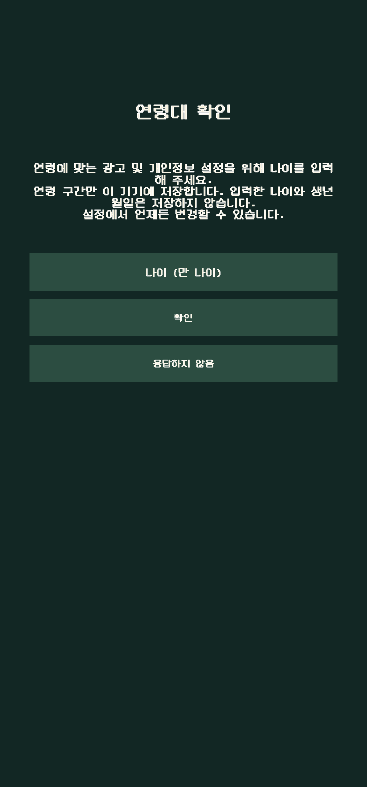

# 원래 연령 화면의 실물 촬영 가림 보완 — 2026-11-07

기존 PHOTO 시험 앱에서 진단 OnGUI가 원래 연령 창의 제목을 가렸습니다. PHOTO 심볼에서 원래 연령 모달이 입력을 소유하면 OnGUI 표시만 생략하도록4줄 보완했습니다. 나이 선택/모달 닫기·입력 소유권·관측 로그/대기 예산을 바꾸지 않습니다. 운영 Player 및 PHOTO가 아닌 fixture에는 이 표시 조건을 추가하지 않았습니다.

source `6f4de3818b67f8095d9c911d564cf09a19344f5d`에서 별도 PHOTO ARM64 APK1회를 생성했습니다. Unity6000.3.25f1/min25/target36, CLI exit0/BuildReport Succeeded·errors0·warnings18입니다. 백업 whitelist/검사 클래스는48/48 때와 바이트가 같아 해당 결과를 재사용했고, 새48회 실행으로 합산하지 않았습니다. 이번 OnGUI 변경은 실제 PHOTO Player 컴파일과 기기 렌더로 확인했습니다.

고정 출력은 새 APK를 별도 보관한 뒤 기존 파일을 복구하도록 분리했습니다. 보호7,146파일(이전 출력 포함)/파일 집합·키/JDK·두 ADB 옵션 원값1/clean·소유 Job0을 확인한 뒤 기기로 넘어갔습니다. APK의 오프라인 권한/provider 차단·백업/기기 이전18개 제외·서명/ARM64/min25/target36·native 기본 검사를 통과했습니다.

실물 SM-N986N/Android13/4KB에서 정확한 기존 PHOTO SHA를 대조하고 삭제/초기화 없이 업데이트했습니다. UID·dataDir·최초 설치 시각을 유지했습니다. 원래 제목과 설명·빈 입력·두 버튼 전체가 진단 패널 가림 없이 표시됐고, 입력 초점1회로 숫자IME/입력·버튼 위치를 확인한 뒤 Back1회로 숨겼습니다. 같은 PID, 원래 빈 안내·연령 대기와 격리 로그 수집이 유지됐습니다. 나이 숫자·확인/응답하지 않음·Enter/Done과 실제 인증 조작은0입니다.

[숫자 키보드 원본과 촬영 조건](../images/age-input-physical-20261107/README.ko.md)을 함께 확인합니다. 이미지를 편집해 진단을 지운 것이 아니며 진단 렌더 조건을 수정한 앱의 실제 캡처입니다.

자체 앱 중지/HOME·Editor/소유 Job0·원본/두 옵션·공유 ADB 신원을 확인하고 실제 반환했습니다. 별도로 설치한 운영 Play31도 stopped=true/notLaunched=true를 유지했습니다. 운영 계정/저장/NoAds·연령별 실제 SDK/광고·실물16KB·다른 기기/노치/런처 마스크와 최종 사용자 UI 검토는 별도입니다. APK SHA-256은 `3b2a0af1c4b45d94dfe4e98b932f39097da6979886c99cef711adba0fd31d4ee`, 82284696bytes입니다.
