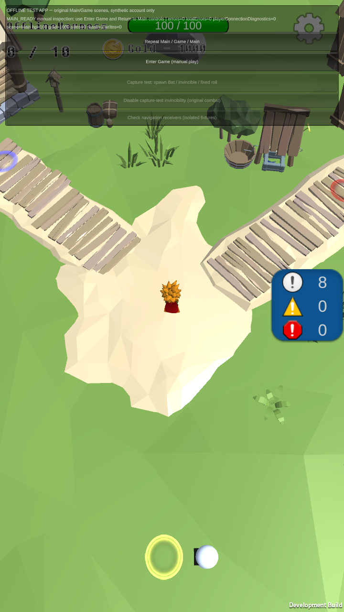

# 최신 일반 오프라인 게임 APK 준비 — 2026-10-24

**최신 통합 소스로 일반 게임 APK를 만들고, AdServices3권한 제거와 같은 파일의 LD 첫 Main 표시를 확인했습니다.** 빌드·실제 APK 정적 검사·기존 출력 보존·로컬 전달 준비와 기기 업데이트 후 첫 화면 확인까지 완료했습니다. Drive 업로드·실제 폰·이 새 파일의 Game 왕복은 미실행입니다.

| 항목 | 실제 결과 |
| --- | --- |
| source | `c6b4ba136f7f211c712b2c66d062eb8c9d710342` |
| 실행 | `RevivalGameplayBuild.BuildAndroid`,18:04:19~18:08:18 KST, exit0 |
| 도구 | Unity6000.3.25f1/e1dba0a9aba4, CLI1.0.0-beta.8, JDK17/Build Tools36.0.0 |
| 앱 | `com.AeDeong.MonsterTamer.revival.gameplay`,1.0.5/code26/debug, min25/target36/ARM64/IL2CPP |
| 새 APK | `Tamer-gameplay-c6b4ba1.apk`,110727684 bytes |
| SHA-256 | `cf666b84aaa91948b8d0d4b7ab172f60ca09bd2eee0dd11763744d00e04c1ffc` |
| 실제 manifest | INTERNET/ACCESS_NETWORK_STATE/BILLING/GMS AD_ID/AdServices3권한, 광고·PGS 초기화 provider2개 부재 |
| 실제 서명 | 기존 일반 APK와 같은 단일 debug 인증서 SHA-256 |
| 보호 | 현재 원본62개 before/after 원문·해시 대조, 변경 설정8개 복구, clean·Editor 종료 |
| 기존 출력 | 이전 APK 원래 경로·파일 identity·bytes 복구, 이전 로그/provenance·전달본 불변 |
| 전달 준비 | 새 APK·SHA256SUMS·한국어 설치/첫 확인 안내3파일, 독립 복사 후 해시 대조 |
| 소스/네이티브 | 소스 사전검사12/12, native6개 LOAD/ZIP·보수적 RELRO layout 통과 |
| 정확한 파일 실행 | LD Tamer의 설치물 SHA/크기 일치·같은 debug 서명/UID/user0/code26 업데이트·첫 Main 확인·해당 앱 종료 |

빌드 전 소스는 clean c6 기준으로 고정했습니다. 보호 실행기가 승인된 Editor Pipeline의 `m_AutoStart`를 일시 비활성화하므로 CLI provenance의 `source.dirty=true`를 보존합니다. 실제 delta8개를 확인한 뒤 해당62개 원본을 검증·복원했습니다. 이 임시 설정 변경을 숨기거나 실행 시작 전체가 clean이었다고 표현하지 않습니다.

이전 [10월23일 일반 후보](gameplay-delivery-20261023.ko.md)의 APK SHA `feb3a938abf7a0055032d942521cebb371b18824a32f09b857bcbc6a823ed371`에는 AdServices3권한이 실제로 남아 있었습니다. 최신 `OfflineManifest`의 제거 설정이 새 merged manifest에 반영됐습니다. 기존 파일은 먼저 독립 백업/readback 후 동일 볼륨의 새 보관 경로로 잠시 이동했습니다. 새 빌드 결과를 별도로 보존한 뒤 기존 파일을 원래 identity로 되돌렸으며 삭제/덮어쓰기는 하지 않았습니다.

남은 권한은 WAKE_LOCK/FOREGROUND_SERVICE/자기 패키지의 DYNAMIC_RECEIVER_NOT_EXPORTED_PERMISSION3개입니다. PGS metadata는 남아 있어 모든 native provider나 SDK 설정이 없다는 주장은 하지 않습니다. 일반 변형에는 `allowBackup=false`/`fullBackupContent=false`/`dataExtractionRules` 속성이 없으며 전체 백업·기기 전송 차단을 보장하지 않습니다. 백업/복원 시험은 실행하지 않았습니다.

추가 raw RELRO 끝 정렬 진단3건은 미통과이고 `--strict-relro`는 요청하지 않았습니다. 다른 UMP 후보의 진단2건과 구분합니다. 정적 검사 성공은 실ARM64/16KB 실행이나 Play 제공물·정책 판정의 근거가 아닙니다. 빌드 종료 로그의 `StackAllocator m_LastAlloc` 진단도 보존했으며 전체 Editor 경고가0이었다고 주장하지 않습니다.

## 사용할 때의 범위

이 일반 변형은 실제 로그인·Store·광고 요청을 차단하고, 프로세스마다 새 합성 프로필로 원래 Main에서 대기합니다. Enter Game/Return to Main·조이스틱·전투·Capture를 사용할 수 있습니다. 오늘의 Login 안내/실제 UMP 재진입 검증에는 각각의 전용 후보를 사용했으며 이 일반 앱의 재빌드로 그 경로를 검증했다고 쓰지 않습니다.

기존 계정 진행도·No Ads 복원이나 재시작 저장을 시험하는 앱이 아닙니다. 설치 오류나 서명 충돌이 생겨도 기존 앱/데이터/캐시를 지우지 않고 오류를 확인합니다. 이번 파일의 첫 Main과 [이전 후보의 LD 왕복](gameplay-delivery-20261023.ko.md)은 서로 다른 실행 근거입니다.

## 정확한 새 파일의 LD 첫 Main — 18:55 추가 확인

실행 소스는 위 c6b4ba1이며 관측 checkout은 문서 변경만 추가된 `72351cfa7b51a6cf647605bcd3a557dfa0e92ad9`입니다. 두 커밋 사이 Assets/Packages/ProjectSettings/tools 차이가 없음을 대조했습니다. LD Tamer/index1, Android14/API34/4096 환경의 기존 앱을 같은 인증서·Android user0·UID10078·code26으로 한 번 업데이트했습니다. 설치 전후 실제 base APK를 보존하고 SHA/크기를 새 파일과 대조했습니다.

첫 실행 전 **내부 files/shared_prefs2개·외부34개**의 내용과 경로가 완전히 같았습니다. 내부 cache 디렉터리까지 포함한 전체 Android 백업으로 표현하지 않습니다. 각 tar는 별도 find 원문 명부 및 파일별 해시와 대조했습니다. 한 번 시작한 PID16482에서18:55:00 격리 표식,18:55:02 Main/HP100/Gold1000/동료0·메모리 서버 reads2/writes0,18:55:03 MAIN_READY/IAP차단1을 확인했습니다. 화면의 개발 시험 오류 카운터는0입니다. UI 입력·씬 왕복·실제 계정/구매·개인 폰 조작은 하지 않았습니다.

로그 전체는 별도로 분류했습니다. 같은 PID의 Android **E73/W7**, 그중 Unity E3/W0이며 초기 PlayerConnection 소켓 진단3건입니다. 나머지 E70은 HostConnection/libEGL/EGL_emulation/eglCodecCommon 태그입니다. ES3.2 미지원 진단 뒤 실제 ES3.1 context 생성·PlayerInitEngineGraphics OK·Main이 이어졌습니다. 캡처 범위에 fatal/exception/ANR 표식은 없지만 모든 진단을 해소했거나 전체 Android 오류가0이라고 주장하지 않습니다. 첫 화면의 카운터는 시작 로그 전수 검사의 대체물이 아닙니다.

동일 앱만 종료하고 PID 부재를 확인했습니다. 기존 외부 non-IL2CPP26파일은 모두 byte가 같았고 삭제0, 새 파일2개는 단일 새 GUID 폴더의 OfflineHarness/합성 owner·빈 도감/보유품·미장착 Sword/Shield·빈 pending journal이었습니다. 바뀐 IL2CPP metadata/GUID cache2개는 새 APK와 byte가 같았습니다. 내부2파일은 전체 byte 불변이 아니며, prefs13항목 중9개 유지/Unity session4항목만 변경·count+1,24byte profile cache는 schema/result/size 유지·실제 앱 업데이트 시각만 변화했습니다. [설치 cache 해석 기준](privacy-product-real-ump-20261024.ko.md)과 같은 구조입니다. 초기 연결 사전검사와 마지막 PID 읽기의 거절·후속 정상 읽기, journal/미장착 슬롯의 스키마 해석 보완도 보존했고 이를 위해 앱을 다시 실행하거나 초기화하지 않았습니다.

로컬 파일과 첫 확인 안내를 실제 결과에 맞춰 갱신했지만 Chrome 보류 때문에 Drive 전달은 대기입니다. 지금 사용자 휴대폰 조작이나 업로드가 필요한 단계는 아닙니다. 이 파일은 Play에 올리는 AAB나 IAP Test32·privacycold29가 아니며, 최종 운영 AAB는 여전히 없습니다. 운영 승인 false/null·`releaseReady=false`를 유지합니다.
