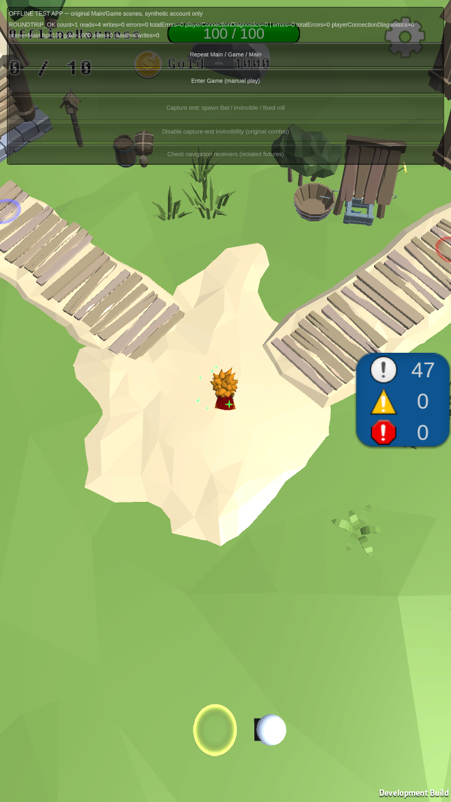

# 전달 APK의 실제 씬 왕복 — 2026-10-24

**같은 전달 APK로 LD Tamer의 Main → Game → Main 왕복을 확인했습니다.** 별도 재빌드·설치·데이터 삭제 없이 이미 설치된 파일을 사용했습니다. 운영 계정·결제·광고·실제 휴대폰 검증은 포함하지 않습니다.

| 항목 | 실제 결과 |
| --- | --- |
| APK 소스 | `c6b4ba136f7f211c712b2c66d062eb8c9d710342` |
| 관측 checkout HEAD | `f49deb858070343f0b79aefbce3bc1c9417f8c0b`; 실행 소스와 Assets/Packages/ProjectSettings/tools 차이 없음 |
| 파일 | `Tamer-gameplay-c6b4ba1.apk`,110727684 bytes/code26/debug |
| SHA-256 | `cf666b84aaa91948b8d0d4b7ab172f60ca09bd2eee0dd11763744d00e04c1ffc` |
| 환경 | Unity6000.3.25f1/e1dba0a9aba4 빌드, LD Tamer/index1/API34/4096, Android user0/기존 UID 유지 |
| 실행 | 22:19:31~22:20:02 KST, 같은 PID3015; 화면 확인 후 Android input으로 왕복 버튼1회 |
| 전환 | Main → NextScene → Game → NextScene → Main; `ROUNDTRIP_OK count=1 reads=4 writes=0` |
| 객체 | 원래 player 유지, Game 적14/생성기 밖0; 반환 Main의 이전 생성기 없음·이전 씬 적0·활성 재사용 적0 |
| 격리 | 로그인·광고 요청 차단, IAP Unavailable, 메모리 서버·새 합성 저장 폴더 |
| 기존 자료 | 이전 외부38파일 모두 원바이트 동일, 추가2파일은 단일 새 GUID의 PlayerData/인벤토리 |

종료 전 전체 PID 로그와 화면을 보존하고 해당 앱만 중지했습니다. 내부 files/shared_prefs2개 중 profileInstalled는 그대로이고, prefs13항목 중 Unity 세션4항목만 변했습니다. 나머지9항목과 기존 외부 게임 파일은 그대로입니다. 내부 cache 전체나 다른 앱의 데이터까지 백업했다는 뜻은 아닙니다.

화면/harness의 `errors=0 totalErrors=0 playerConnectionDiagnostics=0`과 전체 Android 로그를 구분합니다. 전체에는 **E91/W7**, 그중 Unity E3(초기 blocking socket2·multicast1), 나머지 E88(HostConnection1/libEGL16/EGL_emulation4/eglCodecCommon67)가 있습니다. 이 로그를 삭제하거나 Android 전체 오류0으로 보고하지 않습니다. 실제 ES3.1 초기화·씬 왕복 성공은 모든 LD 그래픽 진단의 해소나 실제 ARM64·16KB 성공을 뜻하지 않습니다.

첫 시도 PID2679는 root가 Game에서 돌아오는 NextScene 도중 너무 일찍 중지했습니다. 그 시도는 왕복 성공으로 세지 않습니다. 종료 후 새 인벤토리의 중첩 경로를 분류하는 실행기 assertion도 실패했으며, 원본 before/after와 모든 이전 외부36파일 동일성은 별도로 확인했습니다. 기존 실행기를 보존하고 다음 실행기는 완료·실패 표식을 기다리도록 수정한 뒤 위 PID3015에서만 성공을 확인했습니다. 후속 세션키 명칭 해석 보완은 보존 자료만 다시 읽었으며 앱 재실행은 하지 않았습니다.

원시 tar·파일 명부·PID 로그·실행기·실패/수정 기록은 비공개 근거로 남깁니다. 실제 폰·Drive 전달·운영 정책·서명 AAB·스토어 결과는 별도로 남아 있으며 `releaseReady=false`를 유지합니다. 사용자 수동 확인은 [전달 절차](manual-delivery-and-console-20261024.ko.md)를 따릅니다.
