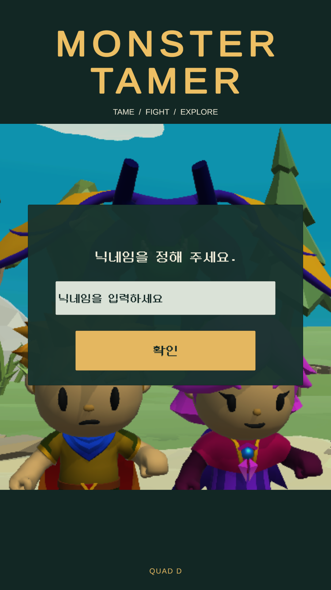
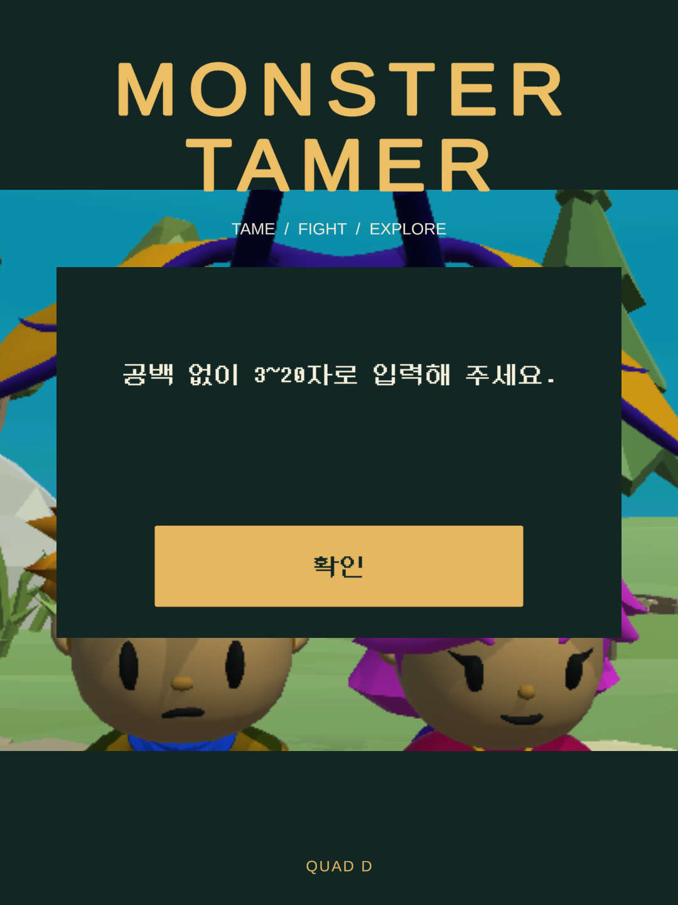
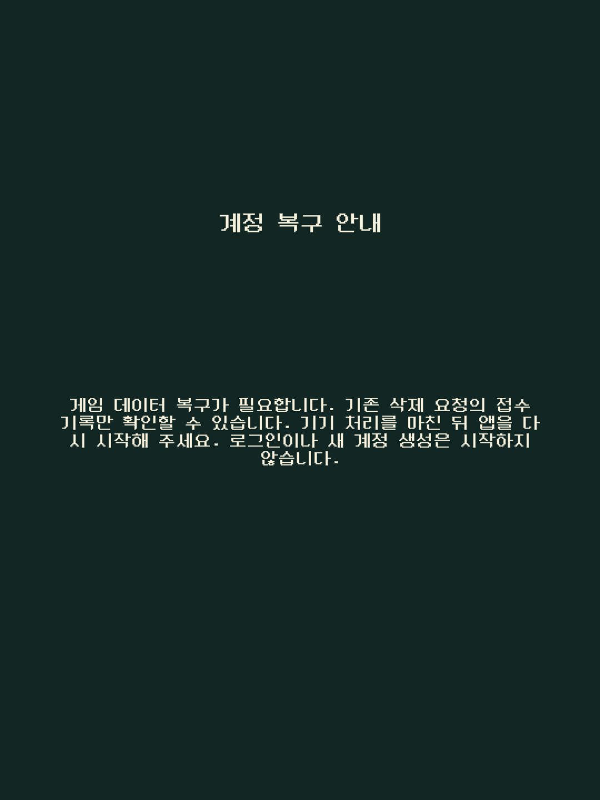

# 로그인·계정 복구 안내의 한국어와 읽기성 보완

로그인 실패·닉네임·기존 계정 복구 안내에 영어가 남아 있었고, 긴 복구 문구가 짧은 로딩 표시 영역을 벗어났습니다. 한국어 문구와 기존 한글 글꼴/공유 재질을 연결하고, 복구 차단 안내를 동작 버튼 없는 별도 읽기 영역으로 옮겼습니다. 닉네임 오류창은 뒤의 입력 글자가 비치지 않도록 불투명하게 표시합니다.

실제 검증 소스는 `be911080f8609a93cd609a0b22c808b0979f3187`, 브랜치는 `codex/login-ui-korean-1107`입니다. 작업본은 `D:/codex/worktrees/tamer-working/Tamer`, Unity6000.3.25f1/revision e1dba0a9aba4·CLI1.0.0-beta.8이며 기본 min25/target36/ARM64 설정을 유지했습니다. 아래는 실제 인증 없이 수행한 Editor 화면/코드 검증입니다.

## 바뀐 표시

- 기존43개 영문 안내(46개 위치)를 한국어로 정리하고 일반 재시도 버튼·닉네임 제목/입력 안내/확인·규칙/중복 안내까지 맞췄습니다.
- 원래80높이의 로딩 문구 영역에 필요높이136.01인 복구 안내가 들어가던 문제를 별도 안내 화면으로 해결했습니다. 이 화면은 로그인·재시도·새 계정 생성 동작을 제공하지 않습니다.
- 닉네임 입력을 기다릴 때 로딩 표시를 숨깁니다. 오류창의 배경과 버튼은 기존 계층/리스너를 유지합니다.
- 글꼴 교체 시 기본 재질의 흰 외곽선이 버튼에 붙던 문제를 기존 한글 입력 필드의 `DungGeunMo-Facelift` 공유 재질로 맞췄습니다. 문구마다 새 Material을 만들지 않습니다.
- 빈 진행도의 새 계정 시작과 기존 진행도/구매 복구의 차이, 삭제 중 재시도 금지, 불확실한 계정 생성 반복 금지 안내를 유지합니다.

## 확인 결과

| 범위 | 실제 결과 |
| --- | --- |
| 기존 계정 검사 | LoginContinuity61 + DeletionReceipt20, **81/81** 통과·실패/보류/건너뜀0 |
| 원래 Login prefab 미리보기 | 로딩/재시도/복구 차단/삭제 계정/새 게임 제안·최종 경고/닉네임·규칙·중복의9상태 × 1080×1920·2400·1440 = **27경우** 통과 |
| 표시 기준 | 대상 글자 높이·화면 내 배치·버튼 겹침/공유 한글 재질 일치·오류창 불투명도 통과. 원본6장 직접 열어 외곽선/뒤 글자 비침과 실제 표시도 확인 |
| 버튼 지정색 대비 | 최소8.260568:1, 내부 기준4.5:1 이상. [W3C 상대휘도 공식](https://www.w3.org/WAI/WCAG22/Understanding/contrast-minimum.html)을 사용한 지정색 계산이며 화면 픽셀 측정과 구분 |
| 일반 Android 코드 | `PlayerBuildInterface.CompilePlayerScripts`, options None/추가 define 없음, **68어셈블리 결과·Assembly-CSharp 출력** 확인. APK/AAB·IL2CPP 네이티브 빌드0 |
| Player 메타데이터 | Cecil 읽기7항목 통과: 정상 시작의 격리 BlockLogin 제외·접수 복구 가드·Android Google/명시 가입 분기·공유 재질 setter·문구·새 Material 생성 제외 확인. 게임 어셈블리 로드/실행0 |
| 계정 코드 보존 | 핵심10메서드의 문자열 외 토큰, 식별자 키 정의와 리스너 등록 수 대조 |
| 원본 복구 | 보호7158파일/보호 집합6961·기존 폰트/고정 이미지·키/JDK·공유 설정 정확 복구. 소유 Editor/자식0으로 반환 |

81검사와68어셈블리 결과는 같은 소스에서 한 번 수행했습니다. 미리보기 도구가 임시 카메라의 대상 텍스처를 해제하는 순서에서 남긴27오류와 종료 시 Pipeline2오류를 보존하고, 도구만 고친 후27화면만 다시 확인했습니다. 해당 재확인의 구조화 Unity 오류는0이며 원시 시작/Mono 종료 진단은 별도로 남겼습니다. 로그의 혼합 UTF-8/CP949 판독 실패는 원시 바이트를 보존한 파일 판독으로 해결했고 추가 실행은 하지 않았습니다. 이전61/81검사나 같은27화면을 더해 성공 수를 늘리지 않습니다.

## 검토 이미지

원래 prefab을 복제해 상태/합성 메시지만 구성한 **Editor 미리보기**입니다. 실제 게임 계정이나 신규 계정 선택 동작을 실행하지 않았으며 폰/Play에서 촬영한 운영 화면으로 사용하지 않습니다. 원본 PNG를 크기/색상 편집 없이 복사했습니다. [이미지 정보](../images/login-ui-korean-20261107/README.ko.md)

## 남은 확인

현재 변경을 담은 새 APK/AAB·운영 서명·수동 업로드·내부 제공은 아직 하지 않았습니다. 기존 전체 후보32는 변경 전 원본이며 이번 문구/재질 보완을 포함하지 않습니다. 새 UI의 실제 Android 표시, Google/손님 운영 로그인·서버 저장/No Ads·연령별 SDK/광고/삭제와 최종 사용자 UI 검토는 [전체 잔여](remaining-recovery-work.ko.md)에 유지합니다. 실제 인증·나이 선택·서명 비밀값 입력과 최종 정책 심사/프로덕션 절차도 그대로입니다.

사용 중인 한글 TTF의 작성자 배포물/사용권 연결은 [별도 글꼴 근거](dung-font-source-20261107.ko.md)로 구분합니다. 이 PR의 화면 개선을 전체 운영 기능이나 모든 에셋 권한 완료로 계산하지 않습니다.
