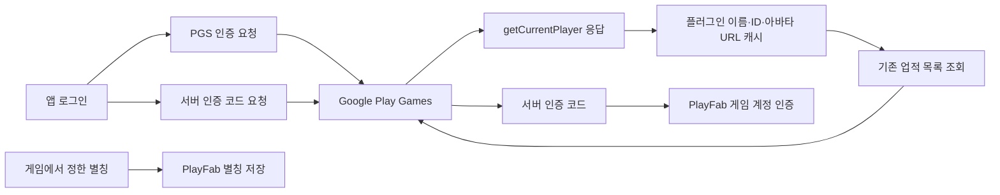

# PGS 인증의 자동 프로필 조회와 신고 검토 범위

2026-10-29, 실제 후보 source `eba77a66f75122f0c0c539ed0d5b006c73d28253`와 Git clean 필터 기준 동일한 소스5개를 읽었습니다. 실제 SDK metadata의 games-v2는22.0.0입니다. **소스의 호출 구성 근거이며 운영 계정 로그인·실제 프로필 값·패킷·서버 보관을 관측한 결과가 아닙니다.**

## 인증 성공 때 플러그인이 수행하는 일

`AndroidClient.SignInOnResult`는 성공 후 `getPlayersClient().getCurrentPlayer`를 요청하고 응답을 `AndroidJavaConverter.ToPlayer`로 변환합니다. 변환은 displayName/playerId/iconImageUrl을 읽어 `Player` 객체에 보관합니다. 이어 `LoadAchievements(ignore => {})`를 시작하며 실제 achievement client의 `load`에는 forceReload=false를 전달합니다.

따라서 앱 Scripts에 직접 GetUserName 호출이 없다는 사실만으로 SDK 전체의 이름/프로필 읽기0을 주장하지 않습니다. 또한 자동 조회를 새 업적 등록·잠금 해제·게임 진행 업로드로 표현하지 않습니다. SavedGameClient/EventsClient 객체 구성 자체도 해당 게임 데이터 전송 성공이 아닙니다.

위 그림은 API 소스에 나타난 방향을 구분합니다. Google→기기 프로필 응답은 앱이 새 이름을 Google에 업로드했다는 증거가 아닙니다. 게임 별칭의 PlayFab 저장과 PGS 자체 gamer identity 처리를 같은 값·수신자로 합치지 않습니다. 실제 인증 코드나 프로필 값은 기록하거나 공개하지 않았습니다.

## 아바타와 추가 인증 scope

일반 `Player` 생성은 `PlayGamesUserProfile` 생성자에서 아바타 URL 문자열을 보관하며 http로 시작하는 정상 URL은 https로 정규화합니다. 이미지 다운로드는 별도의 `image` getter가 호출될 때 시작하는 코루틴 경로입니다. 현재 앱 Login/Managers에서 그 이미지 호출을 찾지 못했습니다. URL 문자열을 받았다는 이유만으로 실제 사진 파일 다운로드·기기 밖 사진 업로드 실적을 추가하지 않습니다. 다른 프로필/친구 API까지 모두 같은 구현이라고 확대하지 않습니다.

현재 앱은 `RequestServerSideAccess(false, callback)` 기본 overload를 사용합니다. `false`는 forceRefreshToken이며 이메일 선택을 부정하는 boolean이 아닙니다. 추가 AuthScope 목록을 받는 overload와 구분하고, 현재 앱 경로에서 추가 EMAIL scope를 요청했다고 쓰지 않습니다.

## Data safety 적용과 미검증

[PGS 공식 데이터 공개](https://developer.android.com/games/pgs/data-collection)는 최신 SDK의 자동 gamer identity/분석·진단과 사용 기능별 데이터를 구분합니다. [공식 약관3](https://developer.android.com/games/pgs/terms)은 controller-controller 조건과 광고 목적 사용 금지를 설명합니다. PlayFab 처리자 예외를 PGS 전체에 복사하지 않으며, 역할 설명만으로 개별 필드의 실제 송신/공유를 관측했다고 쓰지 않습니다.

현재 제공24와 새 후보의 유형별 신고는 [조건부 질문·답안 검토](data-safety-answer-review-20261029.ko.md)와 연결합니다. SDK 자체 신원 처리·사용자 주도 동작 예외·앱 별칭 저장을 구분해 적용 판단을 기록하고 공식 저장 전에 소유자가 검토할 수 있게 준비합니다. 실제 Android payload·네트워크 성공·보관 기간·정책 심사/운영 기능 통과는 별도이며 새 빌드·시험·키·기기/운영 로그인을 실행하지 않았습니다.

소스 연결: [AndroidClient](../../Assets/GooglePlayGames/com.google.play.games/Runtime/Scripts/Platforms/Android/AndroidClient.cs), [변환](../../Assets/GooglePlayGames/com.google.play.games/Runtime/Scripts/Platforms/Android/AndroidJavaConverter.cs), [프로필](../../Assets/GooglePlayGames/com.google.play.games/Runtime/Scripts/ISocialPlatform/PlayGamesUserProfile.cs), [Player](../../Assets/GooglePlayGames/com.google.play.games/Runtime/Scripts/BasicApi/Player.cs), [앱 로그인](../../Assets/Scripts/Login/Login.cs).
