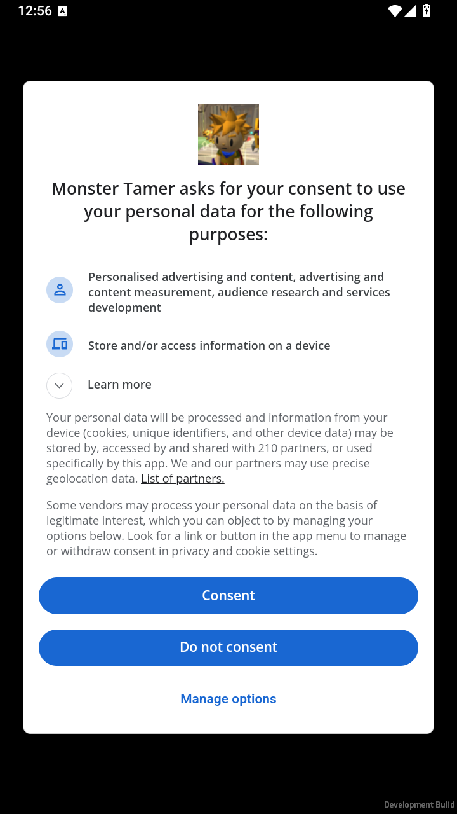

# UMP cold 첫 오류 후 명시 재진입 — 2026-10-24

실행 source는 `9e3f315df5b92a795a16a5b30c40f593c1b2b6e3`입니다. [최초 cold 실패](privacy-cold-20261024.ko.md)를 보존하고, 새 후보의 한 프로세스에서 **첫 실제 오류 → 실제 사전 로딩 완료 → 명시 재진입 → native 폼 표시 → 거절 선택 → 실제 callback 성공**을 연결했습니다. 과거 warm 성공이나 가짜 callback을 새 결과로 옮기지 않았습니다.

## 정확한 후보와 보호

| 항목 | 실제 결과 |
| --- | --- |
| APK | `Build/revival/Tamer-ads-ump-publisher-privacy-age-pgs-isolated-privacy-cold-retry-no-backup.apk` |
| 크기 / SHA-256 | 98,636,463 bytes / `a9dfa7d43766b98f7893e7a7447c8fad31477e9b5b559ec8024ba75210c8e847` |
| 앱 ID | `com.AeDeong.MonsterTamer.revival.privacycold` |
| 전용 시험 버전 | 관측한 설치본26 → 후보27, 같은 debug signer |
| 도구 | Unity6000.3.25f1/e1dba0a9aba4, CLI1.0.0-beta.8, Android min25/target36/ARM64 |
| 실제 실행 환경 | LD플레이어 `Tamer` index1, Android14/API34, 4KB 페이지, ARM64 ABI 지원을 노출하는 에뮬레이터 |
| 격리 | backup=false, native PGS provider/PGS 앱 메타 없음, Managers 없음, Store/운영 계정 API0 |

27은 이 격리 APK만의 버전이며 Play 운영/내부 시험 앱의 code와 무관합니다. 기존 cold APK와 증거는 보존하고 별도 파일로 빌드했습니다. 기존 내부 files/shared_prefs와 외부 fixture15파일을 먼저 보존하고, `install -r` 전후 실제 파일 내용이 모두 같음을 확인했습니다. 앱 데이터 삭제·consent reset·원본 자료 덮어쓰기·새 구매는 하지 않았습니다.

## 최소 변경과 실제 컴파일

- 새 `TAMER_PRIVACY_COLD_RETRY_HARNESS`에서만 기존 cold driver에 저장 fixture 준비와 명시 재진입1회를 추가했습니다. 일반 cold-only/운영 빌드는 이 분기를 사용하지 않습니다. 새 GUI·manager·SDK adapter·공용 gate는 만들지 않았습니다.
- 첫 callback과 두 번째 callback의 ordinal·같은 manager owner·SDK 관측 sequence·pending/terminal을 구분했습니다. 재진입 latch는 호출 전에 소비하고 Show는 최대2회입니다. 추가 Update/Gather·자동 Show·중복/순서 밖 SDK 이벤트·pending 중 연령 저장은 거절합니다.
- 기존 manager의 retained fresh Required owner와 기존 `RequestPrivacySettings()`를 사용합니다. 새 SDK 객체나 Update를 추가하지 않습니다. SDK callback에 closure ID가 없는 제약은 횟수·busy·실제 manager 결과의 결합 검증으로 보수적으로 처리합니다.
- 빌더는 기존3개 opt-in과 관측한 설치 code의 명시 입력을 요구하고, 새 출력과 배타 `.building` 예약을 사용합니다. 임시 versionCode는 finally에 복구합니다. 운영 승인 false/null과 일반 빌드 설정은 유지했습니다.

새 Android 빌드에서 Editor 빌더와 retry Player define을 실제 컴파일했고 exit0/빌드 성공 marker를 확인했습니다. ordinary Editor 결과나 과거900/900을 이 Player 분기의 실행 결과로 대신하지 않았습니다. 변경3파일과 보호 실행기는 독립 정적 검토에서 추가 확정 P1/P2가 없었습니다.

기존59파일과 비공개 메타/본문/기존 서명 파일3개를 포함한62개를 먼저 보존했습니다. 빌드 후 설정8개를 검토·복구했고62개 내용 검증·Editor 종료·Git clean을 확인했습니다. 추가3개는 read-only 복구 범위로 보호하여 덮어쓰지 않았습니다. 후속 전체 에셋 검사는4,561/복사0/SDK 메타7/명시 private 메타1, 출시 소스 검사12항목 통과이며 `releaseReady=false`입니다. 네이티브6개의 LOAD/ZIP·보수적 RELRO layout은 통과했고 엄격한 끝 정렬 진단2건은 남깁니다. 실제16KB 환경 검증이 아닙니다.

## 실제 순서와 결과

| 단계 | 이번 후보의 실제 관측 |
| --- | --- |
| PID7760, 업그레이드 후 첫 실행 | 기존 Declined와 합성 No Ads 복구, 자동 Update0/Show0. 명시 fixture 준비 후 Adult/No Ads 저장, SDK0 |
| PID8010, 새 프로세스 | 저장 Adult/합성 No Ads 복구, 요청 전 Update0/Show0 |
| 최초 명시 요청 | 실제 Update1/성공 callback1 → fresh Required 읽기1 → Show1 → 실제 FormFailed/code3 callback1, busy=false/재진입 가능 |
| 로딩 원인 근거 | 같은 PID의 SDK가 폼 사전 로딩 중이라고 진단했고 그 오류 뒤 실제 `load_complete`를 기록. code3 전체를 같은 원인으로 일반화하지 않음 |
| 명시 재진입1회 | coordinator file 명령 → 같은 retained owner → Show2, Update 총1. callback 총1인 동안 busy=true/Checking/terminal=false/재진입 latch 소비 |
| native 폼 | 정확한 시험 package foreground와 실제 캡처를 확인한 뒤 화면의 `Do not consent`를 ADB native input으로 선택 |
| 실제 두 번째 callback | 성공/code0, OptionsClosed/busy=false, Update1/읽기1/Show2/callback2, terminal source ordinal2, 같은 owner, 합성 No Ads 유지 |
| 완료 후 연령 저장 | 실제 두 번째 terminal 뒤 Declined 저장. 첫 오류 terminal이나 pending을 완료로 오인하지 않음 |
| PID8542, 다시 새 프로세스 | 저장 Declined/합성 No Ads 복구. 명시 privacy 요청은 AgeRequired로 차단, Update0/Show0/callback0 |

아래는 이번 후보에서 직접 확인한 native 폼입니다. Developer file 명령은 폼 재진입을 위한 명시 시험 입력이며 일반 MainPanel 버튼의 실제 터치 검증으로 표현하지 않습니다. 거절 선택 자체는 화면에 보이는 native 버튼을 사용했습니다.

첫 Show의 실패1건은 그대로 남깁니다. 이후 명시1회 성공과 구분하며 성공을 위해 오류를 숨기거나 자동 반복하지 않았습니다. 세 PID의 수집 구간에서 fixture failure marker와 Unity Error/Warning/Fatal 줄은0입니다. SDK 첫 오류나 전체 Android native 진단이0이라는 뜻은 아닙니다. 시험 뒤 해당 package만 종료했고 기존 외부 증거15개도 그대로 보존했습니다.

## 남은 범위

- 일반 MainPanel의 실제 Android 오류 안내/버튼 표시·활성·터치와 운영 로그인/동의 흐름의 결합은 미검증입니다. [관련 Editor UI 검사](privacy-form-retry-20261024.ko.md)와 이번 standalone SDK 결과를 구분하므로 #419는 남은 범위를 유지합니다.
- 이번 화면의 `Do not consent` 선택을 전체 목적·공급자·정당한 이익 철회 또는 전지역/아동 정책 승인으로 확대하지 않습니다. Adult/No Ads는 합성 fixture이며 실제 구매권한·Store 복원 결과가 아닙니다.
- 기존 실제 SDK 등록 기록은 같은 package·기기·publisher·adapter·UPM과 보존된 앱 데이터의 연속성을 확인해 후보에 결속했습니다. 이번 후보에서 새 SDK 등록을 했다고 표현하지 않습니다. 등록값·publisher 입력·개발자 토큰·원시 로그·비공개 설정은 공개하지 않습니다.
- 설치 전 ADB offline은 설치 전에 거절했습니다. 해당 전송만 재연결한 뒤 실제 설치1회를 수행했고 전역 서버/다른 인스턴스를 재시작하지 않았습니다. 간헐적인 offline의 호스트 원인은 아직 확정하지 않았습니다.
- Chrome 보류, 운영 승인 false/null, 실제16KB·최종 운영 서명 AAB·Play 판정 대기는 유지합니다.
