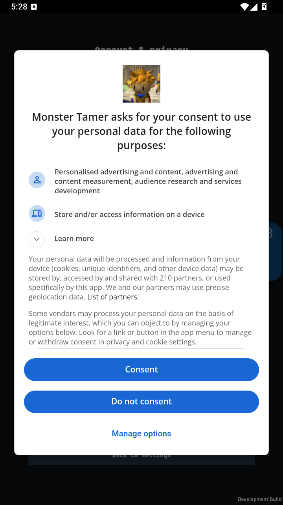
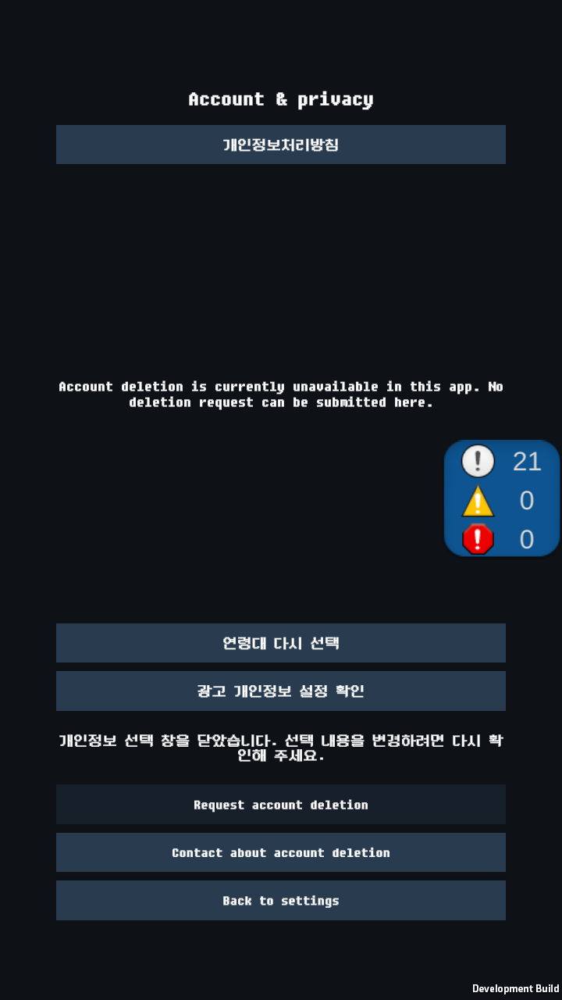

# 원래 개인정보 버튼과 실제 UMP 재진입 — 2026-10-24

**원래 게임의 설정 화면에서 개인정보 버튼을 직접 눌러 실제 UMP 창을 열고, ‘Do not consent’ 선택 뒤 원래 화면과 버튼이 복구되는 것을 확인했습니다.** 개발용 합성 Adult 준비 이후의 warm 재진입 결과입니다. 일반 운영 앱의 최초 cold 진입이나 실제 구매권한 검증으로 확대하지 않습니다.

## 대상과 변경

실행 소스는 `0e3e802616bc0523de91170782280bee46f15436`입니다. Unity `6000.3.25f1`/`e1dba0a9aba4`, CLI `1.0.0-beta.8`, JDK17.0.18/Build Tools36.0.0, min25/target36/ARM64/IL2CPP/debug 서명을 사용했습니다. APK `Tamer-privacy-product-ump-v2.apk`는110,817,720 bytes, SHA-256 `18584f3e274db295ec3b2540e1813f36f634ed0c00ad3d02349d4f3294f572a7`입니다. 패키지는 `com.AeDeong.MonsterTamer.revival.privacycold`, versionCode는29입니다. Play 내부 테스트 제공판의 번호와 구분합니다.

원래 Main/Settings/Account & privacy와 실제 광고 manager를 사용하는 별도 시험 변형을 추가했습니다. 제품 manager API와 운영 정책·승인은 변경하지 않았습니다. 실제 UMP adapter의 기존 관측용 조건부 컴파일 범위만4곳 확장하고, 실제 SDK 파일·의존성·비공개 설정 입력의 provenance를 연결했습니다. 전역 harness define은 추가하지 않았습니다.

## 같은 프로세스의 실제 결과

LD플레이어 Tamer/index1, Android14/API34/페이지4096 환경의 같은 PID13834에서 확인했습니다. 저장된 연령은 Declined로 유지하고 시험 전용 합성 Adult plan을 명시적으로 준비했습니다. 실제 manager의 No Ads getter는 합성 구매 fixture로 true였으며 실제 Store 영수증은 사용하지 않았습니다.

| 단계 | 관측 | 판정 |
| --- | --- | --- |
| 원래 화면 준비 | Main → Settings → Account & privacy를 실제 Android 터치로 열기, SDK Update0/Show0 | 확인 |
| 명시 개발용 준비 | 실제 Update1 성공 → fresh Required → Show1 callback/code3 → FormFailed | 실제 첫 표시 실패 보존 |
| 수동 재진입 | 실제 load_complete 후 원래 개인정보 버튼을 한 번 터치, Update1 유지/Show2, 처리 중 버튼 비활성 | 확인 |
| 실제 네이티브 선택 | UMP 폼 표시 → Do not consent 터치 → 두 번째 callback 성공/code0 | 확인 |
| 원래 화면 복구 | OptionsClosed/busy=false, 두 버튼 활성·전체 안내와 버튼 화면 내 배치·TMP overflow 없음 | 확인 |
| 종료 | 명시 seal/sequence21/command3 → 해당 앱만 강제 중지 → PID 부재 | 확인 |

최종 실제 Update1/Show2/callback2, gather0/managedAdCalls0, 같은 manager owner, 저장 Declined 및 합성 No Ads=true 불변을 대조했습니다. 최초 code3를 성공으로 바꾸거나 자동 재시도로 처리하지 않았습니다. 아래는 편집하지 않은 실제 캡처입니다.

두 번째 화면의 계정 삭제 불가 안내는 이 시험 변형의 삭제 기능 격리 상태입니다. 운영 삭제 접수 결과를 뜻하지 않습니다. 화면의 개발 로그 배지와 Development Build 표시도 유지했습니다.

## 실패 원인과 자료 보존

- 빌드의 조건부 API 참조 오류와69필드 익명 객체가 만든 IL2CPP/clang 중첩 한도 오류를 각각 수정했습니다. 최종 후보는 이름/값 식을 유지하는 Dictionary 관측 출력으로 빌드했습니다. 두 실패와 각각의 설정 복구 근거를 보존했습니다.
- 직전 v28은 SDK 호출 전에 외부 임시 입력의 쓰기 권한으로 실패했습니다. 새 v29는 새 fixture의 앱 private files에 앱 UID/mode600으로 전달합니다. 입력 사본의 전체 zero/readback/삭제를 확인했고 기존 등록 원문·실패 fixture는 보존했습니다. 이는 저장매체 전체의 보안 삭제를 뜻하지 않습니다.
- 현재 logcat 순환 버퍼의 최초 index 소실은 이미 해시 검증한 원문 archive와 같은 PID의 연속 수집으로 연결했습니다. SDK를 재호출하거나 앱을 재시작해 증거를 대신 만들지 않았습니다. 수집기 APK 해시의65자리 오기는 새 수정본으로 바로잡고 기존 거절 기록을 보존했습니다.
- v28→29 설치 직후 내부5/외부46파일의 내용이 완전히 같았습니다. 실행 종료 후에는 **전체 파일 byte 불변 검사가 실패**했고 그 원문을 유지했습니다. 별도 대조에서 Unity prefs의 정확한4개 session 키, SDK의 동의 record ID, AndroidX profile 설치 cache의 앱 업데이트 시각, 새 APK와 byte가 일치하는 IL2CPP metadata/GUID cache만 바뀐 것을 확인했습니다. 그 밖의 prefs 값·기존 파일은 유지됐고 기존 non-IL2CPP 외부38파일은 모두 byte가 같았습니다. 추가28파일은 새 시험 폴더 안에만 있으며 기존 파일 삭제는 없습니다. 앱 종료 완료와 stop helper의 전체 strict 검사 실패를 구분합니다.

AndroidX cache의 형식과 업데이트 시각 의미는 [공식 ProfileVerifier 소스](https://raw.githubusercontent.com/androidx/androidx/androidx-main/profileinstaller/profileinstaller/src/main/java/androidx/profileinstaller/ProfileVerifier.java)의 Cache 읽기/쓰기 구현과 대조했습니다. 이 분류를 위해 앱 데이터 초기화·rollback·추가 SDK 호출은 하지 않았습니다. 원시 로그·입력·동의 record 값은 공개하지 않습니다.

## 검증 범위와 남은 일

최종 빌드 exit0, 보호62파일 원본 검증/변경 설정9개 복구/clean/Editor 종료, 소스 사전검사12/12를 확인했습니다. APK의 native6개 LOAD/ZIP·보수적 RELRO layout은 통과했습니다. 추가 raw RELRO 끝 정렬 진단은2건 미통과이며 `--strict-relro`는 요청하지 않았습니다. 실제16KB 환경 통과와 구분합니다.

최종 manifest는 네트워크2권한과 이전 후보에서 확인한 SDK 보조3권한만 포함하고, 자체 receiver 권한의 signature 선언을 대조했습니다. Billing/AD_ID/AdServices 권한과 PGS 초기화 provider·APP_ID는 없습니다. 네이티브 GMA provider는 존재하므로 모든 SDK/Analytics 네트워크 호출이0이라는 주장은 하지 않습니다. 백업 비활성 및 실제 참조된 cloud/device-transfer 전체 제외 규칙도 확인했습니다.

[가짜 SDK를 사용한 원래 UI 중복 입력·이전 callback 시험](privacy-product-ui-20261024.ko.md), [별도 실제 UMP cold 후보](privacy-cold-explicit-retry-20261024.ko.md), 이번 실제 SDK+원래 UI warm 시험은 서로 다른 근거입니다. 운영 최초 버튼/일반 연령 흐름·모든 목적/공급자 동의 철회·실제 구매권한·운영 계정/저장/삭제·광고 보상·최종 서명 AAB/Play 판정은 미검증입니다. 운영 승인 false/null·`releaseReady=false`, Chrome 작업 보류를 유지하며 #419는 남은 운영 경계 때문에 OPEN으로 둡니다.
