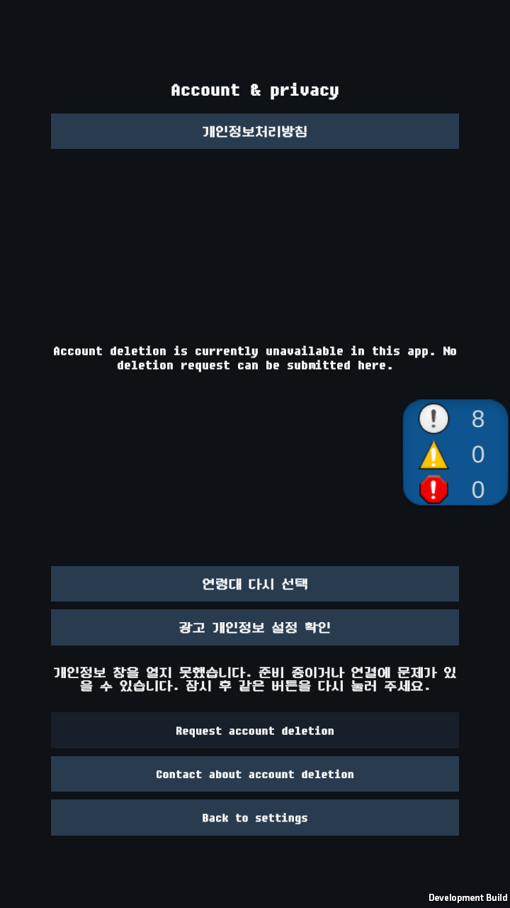

# 개인정보 설정의 실제 Android UI 관측 — 2026-10-24

**검증 범위는 원래 Main/설정/계정·개인정보 화면과 실제 Android 터치입니다. 광고 SDK 응답은 이 시험 전용 가짜 adapter를 사용합니다.** 앞서 별도 앱에서 확인한 [실제 UMP cold 재진입](privacy-cold-explicit-retry-20261024.ko.md)과 합쳐 운영 흐름 전체 통과로 표현하지 않습니다.

## 변경

제품 UI와 광고 manager의 API는 변경하지 않았습니다. 별도 개발 앱의 기존 정상 Main에 최소 시험 경로를 추가했습니다. 원래 Settings와 Account & privacy 및 개인정보 버튼을 Android 터치로 조작하고, 가짜 응답만 명시적인 작은 파일 명령으로 전달합니다. 제품 버튼을 `onClick.Invoke`로 호출하는 시험과 구분합니다.

긴 JSON을 Android Unity 로그에 출력하면 이번 환경에서 payload가 1,024 bytes에서 잘렸습니다. 최초 후보의 전체 결과를 보존한 것으로 표시하지 않았으며, 새 후보는 단계별 JSON을 `CreateNew`/`Flush(true)`로 저장한 뒤 전체 bytes를 재확인하고 짧은 SHA-256 index만 로그로 남깁니다. 화면 범위·TMP overflow·원래 버튼 raycast 검사도 완료 index보다 먼저 수행합니다. 첫 후보와 새 후보는 서로 다른 앱 ID/출력으로 보존하며 데이터 삭제나 prepared 상태 재사용을 하지 않습니다.

## 실제 대상과 결과

새 source `896b16347c1f6695041128e12f401c87f1932002`, Unity `6000.3.25f1`/`e1dba0a9aba4`, CLI `1.0.0-beta.8`, JDK17/Build Tools36.0.0, min25/target36/ARM64/IL2CPP/debug 서명입니다. 새 APK `Tamer-privacyproductui-v2.apk`는110,828,311 bytes, SHA-256 `97830e012cd093c37e604664f980783d2c96eec53eae4697c9073f5351e4a286`입니다. 앱 ID는 `com.AeDeong.MonsterTamer.revival.privacyproductui29`, versionCode는26이며 이름의29는 Play 업로드 번호가 아닙니다. LD Tamer/index1의 같은 PID11413에서 아래 결과를 확인했습니다. 빌드의 공유 JDK 실행 파일과 고정 Editor JDK의 bytes 일치도 확인했습니다.

| 단계 | 실제 UI 입력과 확인 | 결과 |
| --- | --- | --- |
| 오류 안내 | 긴 한국어 전체·연령/개인정보 버튼 가시성·자동 재시도 부재 | PASS |
| 명시 재진입 | 원래 개인정보 버튼 한 번, 동일 owner Update1/Show2 | PASS |
| 중복 터치 | Checking 동안 두 버튼 비활성, 추가 터치로 호출 증가 없음 | PASS |
| 이전 응답 | 첫 요청의 늦은 응답을 전달해도 Checking 유지 | PASS |
| 정상 종료 | 두 번째 요청 응답 후 OptionsClosed·버튼 재활성화 | PASS |

첫 후보 source `3ea5a82`/APK SHA-256 `af9dc6b685396f9fcf32e56cda97e98cf63db6c05709662c0e9ab2bac1bb789b`/110829103 bytes에서도 위 네 상태와 화면을 관측했지만, 로그 뒷부분은 잘려 미확인으로 남겼습니다. 새 후보의 완전한 파일 관측과 같은 실행으로 합산하지 않습니다.

원래 오류 안내와 두 버튼을 실제 Android에서 캡처했습니다.

네 단계 JSON 전체(1,675/1,584/1,577/1,624 bytes)의 schema/순서/PID/파일명/길이/SHA를 index와 대조했습니다. Update1/Show1→2→2→2, 실제 개인정보 click0→1→1→1, busy false→true→true→false, 두 버튼 true→false→false→true와 불변의 가상 B/legacy hash를 확인했습니다. 가짜 첫 callback은 두 번, 두 번째는 한 번 전달했고 gather0/submissions0/fixture errors0입니다. 정상 종료 화면도 직접 확인한 뒤 이 시험 앱만 종료했습니다.

최초 전송 offline 거절·수집 중 간헐적 ADB 오류·동일 label의 보고서 덮어쓰기 방지 거절은 기록에 보존했습니다. 앱 재시작이나 prime 재전송 없이 PID11413에서 계속했습니다. 알려진 offline 개발 PlayerConnection socket 오류3건은 fixture 오류0과 구분합니다. 원시 로그는 비공개로 보존합니다.

## 보호와 한계

- 저장 연령 Declined/No Ads=false인 별도 가상 profile, IAP Unavailable/삭제 Unavailable/서버 가짜입니다. 앞선 privacycold의 합성 No Ads=true fixture와 다릅니다. 실제 기존 구매 권한을 변경하지 않습니다.
- 최종 APK에서 네트워크·결제·광고 ID 권한과 광고/PGS 초기화 provider 부재, 백업 비활성 및 실제 참조된 cloud/device-transfer 전체 제외 규칙을 대조했습니다. PGS metadata는 남아 있으며 metadata 부재까지 주장하지 않습니다.
- 기존 시험 앱/원본/서명키/비공개 에셋을 유지합니다. 빌드 전후 보호62개 원본과 실제 변경을 대조하고 변경한 설정만 복원합니다. 원시 로그·합성 계정 파일·private 설정은 공개하지 않습니다.
- LD Tamer/Android14/API34/4KB 환경의 관측입니다. 실제 UMP·운영 광고·로그인·삭제·구매·최종 AAB·실기기·16KB·스토어 심사 완료 근거가 아닙니다. 운영 승인 false/null 및 releaseReady=false는 유지합니다.

빌드 후 보호62개 검증/설정8개 복원/clean/Editor 종료·소스 사전검사12/12를 확인했습니다. 새 APK의 native6개 LOAD/ZIP·보수적 RELRO layout은 PASS, 엄격한 raw RELRO 끝 정렬 진단3건은 별도 미통과입니다. 실제16KB 통과나 이전 후보의 진단2건으로 바꾸어 적지 않습니다.
