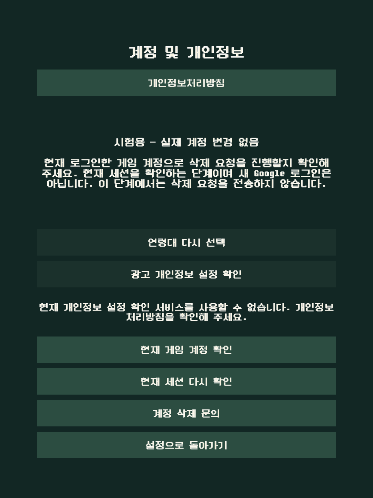
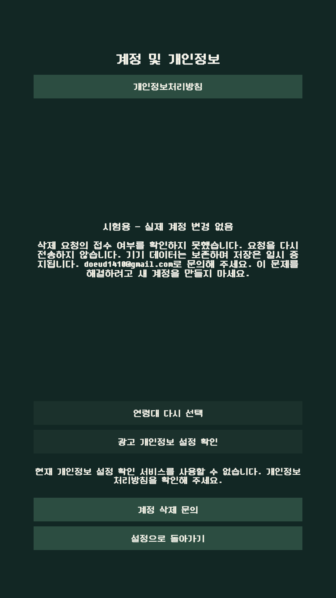

# 계정·개인정보 삭제/복구 UI 한국어 보완 — 2026-11-07

기존 한국어 게임에서 계정·개인정보 메뉴와 삭제·접수 복구 안내가 영어로 남아 있었습니다. 버튼과 상태 설명을 한국어로 맞추고, 요청 접수·접수 여부 미확인·최종 삭제 완료를 구분했습니다. Login의 삭제/접수 복구 화면에도 이미 직렬화된 한국어 계정 폰트를 우선 사용합니다. 삭제 처리·계정 선택·인증·재전송·정리 조건은 유지합니다.

검증 코드는 `2c4016613fa0f0f6d4619c5cd140d6eac2aae63e`이며 앞선 문구 커밋은 `744295aa237e4087ca8e2160d592747803717f05`입니다. checkout은 `D:/codex/worktrees/tamer-working/Tamer`, Unity6000.3.25f1/기본 Android min25·target36·ARM64를 유지했습니다. 새 Player/AAB/서명·실제 계정·나이 조작·기기 명령은0입니다.

## 변경 범위

- 설정 메뉴·제목: `계정 및 개인정보`.
- 삭제 요청/확정/세션 확인/접수 상태/취소/문의/닫기와 복구 화면의 안내를 한국어로 표시합니다.
- 접수를 삭제 완료로 안내하지 않습니다. 불확실한 요청의 재전송 금지·기기 데이터 보존·기존 계정 확인과 문의 경로를 유지합니다.
- 기존 Google/손님 첫 진입에 연결된 한국어 폰트 자산을 삭제 복구/접수 복구에서도 사용합니다. 새 폰트나 전역 fallback을 추가하지 않았습니다.
- 심사 접근 안내 초안은 다음 후보의 한국어 메뉴와 현재 제공31의 영어 `Account & privacy`를 구분합니다. Console의 실제 안내·공개 정책/시행일은 변경하지 않았습니다.

## 실제 검증

기존 `RevivalDeletionUITests`12/12를 실행했습니다. 별도 확인/삭제 확정의 분리·불확실한 전송의 반복 금지·결과/대기/취소 표시·늦은 응답과 창 재열기·접수 후 닫기 동작 등 기존 조건을 유지합니다. 문구 기대값과 실제 한국어 폰트 사용만 검사에 반영했습니다. fake gateway·메모리 복구 저장소만 사용하며 실제 인증/계정 삭제는 하지 않았습니다.

다음은 같은 소스에서 원래 설정 UI 생성 경로와 한국어 폰트를 쓰는 Editor 미리보기입니다. 모든 경우 버튼이 화면 안에 있고 서로 겹치지 않으며, 안내문이 할당된 폭/높이에 들어갔습니다.

| 미리보기 해상도 | 서비스 불가 | 삭제 범위 확인 | 현재 계정 세션 확인 | 접수 여부 미확인 |
| --- | --- | --- | --- | --- |
|1080×1920|통과|통과|통과|통과|
|1080×2400|통과|통과|통과|통과|
|1080×1440|통과|통과|통과|통과|

별도 geometry12경우를 기존 UI12개와 같은 검사 수로 합산하지 않습니다. 수정 미리보기에서는 관련 소스/검사와 이전 XML의 SHA가 같음을 확인해 기존12를 재사용했고 새 UI 검사 실행은0입니다. 원본 이미지 중 짧은 화면·긴 화면 등6개 표본을 직접 열어 글꼴·제목·안내/버튼 표시도 확인했습니다.

원본 TTF의 Unicode cmap을 읽어 새 문구의172개 표시 문자를 모두 지원함을 확인했습니다. 저장된 SDF의138자는 동적 캐시라 이 목록만으로 글자 누락을 판정하지 않았습니다. [OpenType cmap 규격](https://learn.microsoft.com/en-us/typography/opentype/spec/cmap)을 해석 기준으로 사용했으며 실제 글꼴 지원 결과는 보존된 원본 TTF에 대한 읽기 결과입니다. 새 문구 모든 상태의 실제 Android 렌더를 완료했다는 뜻은 아닙니다.

## 도구 실패와 복구

첫 미리보기는12장의 PNG를 만든 뒤 Unity Rect/Vector2의 계산 속성을 JSON으로 직렬화하는 과정에서 순환 참조 오류가 났습니다. CLI 종료0/바깥 success를 통과로 간주하지 않고 내부 실행 실패·최종 receipt 부재를 보존했습니다. 좌표 출력만 x/y/width/height의 일반 숫자로 바꾼 다음 미리보기1Editor를 다시 실행했습니다. 최종12개 geometry가 통과했고,12장의 PNG가 첫 생성본과 SHA까지 같음을 확인했습니다.

기존 고정 검사 이미지3장은 원본을 보존하고 새 결과를 별도 경로에 복사한 뒤 정확 복구했습니다. 미리보기 중 생성된 동적 SDF 캐시·기존 URP 설정·ProjectSettings도 기록 후 원본7154항목/보호 집합6961·키·선택 JDK와 함께 복구했습니다. Library/이전 증거를 삭제하지 않았습니다.

마지막 범위는 실제12:35:34.690698UTC/신규중지12:43:34.690698/전체반환12:45:34.690698이었고, **실제 전체 반환은12:38:23.850984UTC/21:38:23KST**였습니다. CLI0·소유Job27 active0/강제0·전체Editor0·두 공용 ADB 종료 옵션의 원DWORD1·공유 ADB49852 수명 보존을 확인했습니다. Editor 수명 전체와 다른 프로젝트 기기를 직렬화했습니다.

## 원본 미리보기와 남은 확인

두 이미지는 편집·크기 변환 없는 Editor 오프라인 원본입니다. `시험용 — 실제 계정 변경 없음` 표시는 fake flow임을 알리는 표시이고, 비활성 연령/개인정보 버튼과 서비스 불가 안내는 live Managers/SDK를 연결하지 않은 fixture의 상태입니다. 실제 운영 서비스의 이용 가능 판정이 아닙니다.

실제 Play31은 이 문구 보완 전 제공판입니다. 새 최종 후보/정상 Play 전달 후 실제 계정·서버 저장·No Ads/복원·연령별 SDK/통신·삭제 공급자 처리와 사용자 최종 UI/스토어 검토를 이어가야 합니다. 현재 브라우저 URL 판독 중단과 직접 인증/나이/서명 단계의 경계를 유지하며, 새 정책 심사/프로덕션은 진행하지 않았습니다. 전체 잔여는 [복구 작업 목록](remaining-recovery-work.ko.md)에 있습니다.
