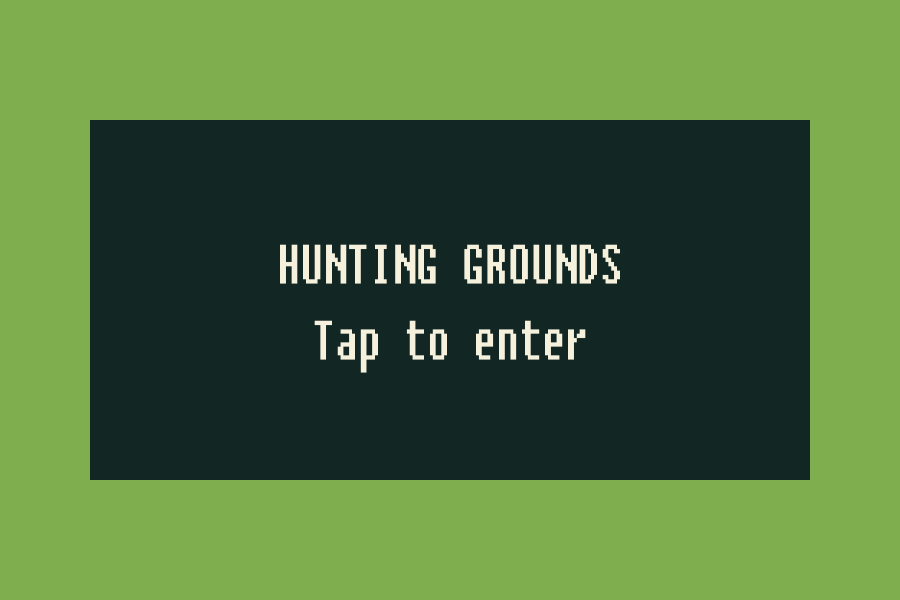
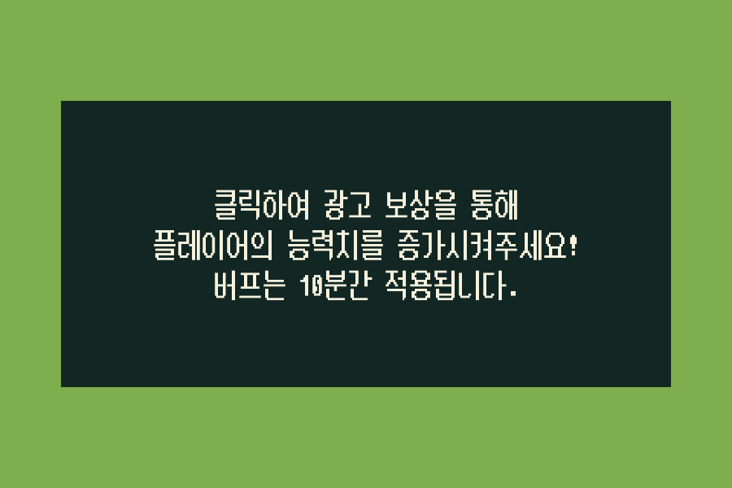

# 아이콘·UI 페이스리프트 검토안 — 2026-10-29

사용자 요청으로 앱 아이콘과 게임 전반 UI의 첫 스타일을 적용했습니다. 실제 작업본은 `D:/codex/worktrees/tamer-working/Tamer`, UI 코드 커밋은 `codex/ui-facelift-1029@493b87dbc57a1b55d19302aac239e50a310b36dc`입니다. [인트로 PR #492](https://github.com/ChoiDaeYoung-94/Tamer/pull/492)를 기반으로 하며 [이슈 #491](https://github.com/ChoiDaeYoung-94/Tamer/issues/491)에서 추적합니다. 사용자 화면 검토와 운영 검증이 남아 있어 완료·배포 상태로 표현하지 않습니다.

짙은 녹색 패널과 금색 주요 버튼, 밝은 본문으로 표현을 통일했습니다. 로그인 제목·로딩·닉네임 입력, 마을/전투 공통 HUD와 포획·설정 버튼, 플레이어 정보 팝업, 상점 탭·목록·구매 안내, 설정·종료/회복 팝업, 캐릭터 선택·조이스틱·전환 화면을 다듬었습니다. 상점에는 기존 팝업 닫기 동작으로 연결한 명시적 닫기 버튼을 추가했습니다. No Ads의 고정 가격 문구는 제거하고 Google Play에서 실제 가격을 확인하도록 안내합니다.

기존 금발 캐릭터와 박쥐 동료를 살린 새 아이콘을 제작해 기본·Android legacy/round·adaptive 슬롯에 연결했습니다. 적응형 아이콘은 별도 투명 전경과 단색 배경을 사용합니다. [최종 에셋·도구·전체 프롬프트](../images/facelift-assets-20261029.ko.md)를 함께 기록했습니다. 한글이 필요한 설정/개인정보 UI의 기존 글꼴과 원래 atlas를 유지하고 별도 재질로 외곽선만 정리했습니다.

## 현재 확인 — 22:30 KST 근접 안내판·포획 실제 동작

source `83cfd19216c20bdb01aa866d39d8b8566054070d`의 격리 UI APK(130793669B/SHA-256 `0becb38d05ee68ea8ea2fb086f2f07238db178ac17c1c62a52b3270d0f52b4ab`)를 기본 검사하고 원본84파일 복구/Editor 정상 종료 후 기존 own UI 앱만 데이터 보존 갱신했습니다. 기존19개 비시스템 앱/Tamer15개를 유지했습니다. 관련 상호작용7/7과 변경 없는 기본10개 결과를 구분합니다.

실제 기기에서 설정 OK를 눌러도 뒤의 안내판이 작동하지 않고 Main에 남음을 확인했습니다. 일반 근접 위치와 이전 실패의 경계 가림 조건에서 각각 안내판→NextScene→Game 이동을 확인했습니다. 후자의 원래 ray는 `Walls/nontrigger`, 새 선택은 `FaceliftClickTarget/GoGameScene`이어서 실제 원인에 대한 수정 확인입니다. 앞선8943a70의 입력 가설/실패1회는 아래 이력으로 보존합니다.

자연 전투의 포획 가능한 시체에 원래 조이스틱으로 접근해 Capture 버튼을 누르고 Bat 동료0/10→1/10을 화면·로그에서 확인했습니다. HP/RNG/적 생성 주입은 없었습니다. 최초45초 관찰에서는 시체가 선택 범위 밖이어서 버튼 조건이 안 됐고 실제 접근 뒤 선택됐습니다. 포획한 Bat는 이후 전투에서 사망하여0/10으로 돌아왔습니다. 따라서 이 실행을 살아 있는 동료의 재실행 복원 검증으로 표현하지 않습니다. 원래 로비 확인→Main 복귀, HP200/가상gold7144 저장·reads4/writes2/장비 유지/오류0을 확인했습니다. 원시 화면·시점별 로그는 비공개 보존합니다.

상점 성공→목록/실패→설명 유지 수정은 앞선8943a70 Android에서 통과했고 이후 로직 변경이 없습니다. 실제 캐릭터 양방향 선택/저장/새 프로세스 복원과 게임오버 복귀는678816c 기록을 연결합니다. 남은 UI 범위는 실제 노치/다른 기기 비율·launcher/스토어 자료·사용자 디자인 검토입니다. 운영 후보27 첫 실행은 [Play 제공 경로에서 차단](candidate27-first-launch-20261029.ko.md)됐으며 격리 UI 통과와 구분합니다.

## 메뉴 뒤 안내판 입력 차단 이력

새 UI층 터치는 일시정지된 메뉴 뒤에서 동작하지 않도록 TimeScale0 조건도 확인합니다. 해당 조건과 양쪽 안내 태그·일반 월드 배제·구매 결과/차단 복귀를 포함한 상호작용7/7을 추가 코드 기준으로 확인했습니다. 앞선 기본 아이콘/격리/안전영역10개 결과와 구분합니다. d471060에서 준비한 Android 빌드는 실제 요청 전이었으며, 이 보완을 포함한 새 커밋으로 한 번 빌드합니다.

## 21:59 KST 실제 기기 재확인과 안내판 입력 원인 정정

source8943a70의 격리 UI APK(SHA256789fadbee309ab68ea7f62815efd76e057093870e7c5a81cb48e80fdbe71d261,109478842B)를 검사하고, 기존own UI 앱만 데이터 보존 갱신했습니다. 전체 비시스템19개/Tamer15개와 운영PID0을 유지했으며 기존Man/SimpleSword/17045G 복원이 확인됐습니다. 가상MasterShield 구매 성공 뒤 확인 한 번에 목록으로 돌아옴을 실제 확인했고, 골드 부족 실패는 상품 설명을 유지하며7045G/서버쓰기1이 변하지 않았습니다. 이 상점 수정은 실제 통과입니다.

반면 근접 안내판 터치는 실패했습니다(입력 보완 시도1). 시험 전용 관찰 로그의 첫 collider는 trigger가 아닌 `Walls`였고, 기존 이동경계의 중심±15/높이15·Renderer없음을 Editor에서 확인했습니다. 앞서 감지trigger로 추정한 입력 필터는 되돌렸습니다. 경계의 물리 동작과 기존 렌더러/콜라이더는 보존하고, 두 안내판에 기존과 동일한 형태의 UI층 클릭 trigger만 추가해 UI 입력 범위를 분리했습니다. 실제 클릭 후 호출하는 기존 이동/보상 함수와 보상 조건은 유지합니다. 일반 월드 collider를 UI 동작으로 취급하지 않는 검사와 두 안내 태그의 경계 가림 재현을 포함해 현재 관련16/16 통과했습니다. Editor API가 만든 신규UI객체6개와 기존부모의 자식목록2개만 유지하고 다른 기존 객체/metadata·원본 설정을 복구했습니다. 이 새 입력 방식은 Android 재확인 전입니다.

## 21:36 KST 캐릭터·마을 Android 확인과 입력/결과 창 보완

source `678816c`의 별도 캐릭터 APK(SHA256 `12bf5e3e1f1b040247c4ae55c001f97851cfaeaaac416cc4fbf952b5048c6230`,109483514B)를 debug/min25/target36/ARM64·네트워크/결제/광고 provider 차단·백업 비활성화로 검사했습니다. 기존 Tamer14개와 기타 비시스템4개를 보존해 별도15번째 Tamer 시험 앱을 plain 설치했습니다. 원본 설정을 복구하고 실제 캐릭터 양방향 전환·설정/계정정보 보기/복귀·Woman 선택 저장/Main 모델 일치·새 프로세스 재실행 후 선택값/20000G 복원을 확인했습니다. 실제 계정/인증/결제/삭제0입니다.

마을의 새 사냥터 안내·광고 준비 중 안내가 패널 안에 표시되고 접근/이탈에 따라 켜지고 꺼짐을 확인했습니다. 기존 사냥터 이동 두 번, 자연 전투/게임오버 두 번과 Main 복귀, Woman의 가상 장비 두 개 구매/장착·200HP/재화 갱신도 확인했습니다. 격리 자료58PNG·각 단계 로그를 보존했습니다. 포획은 자연 조건에서 버튼 표시까지 확인했으나 누르기 전 사망하여 실행은 아직 미검증입니다.

특정 근접 위치의 안내판 터치 미동작과 구매 성공 후 이전 구매 질문이 남는 사례를 기록했습니다. 별도 물리 검사에서 감지용 trigger가 실제 클릭 collider보다 먼저 맞는 경로를 재현하여, 감지 영역을 건너뛰고 실제 장애물에는 막히는 입력 처리를 보완했습니다. 구매 완료 결과 확인은 정확한 결과/상품 팝업만 닫아 목록으로 돌아가고, 실패는 상품 설명을 유지하며 차단 중이면 재시도할 수 있게 했습니다. 기존 확인·가격·구매 판정은 유지합니다. 관련16/16(Editor; 기존10+입력/팝업6) 통과했으며 두 수정의 Android 재확인은 다음 빌드에서 진행합니다.

## 21:03 KST 후속 보완 — 마을 안내판과 캐릭터 검증 준비

사용자 최신 지시로 오늘 작업 한도는23:30 KST/계정 주간90%로 연장했습니다. 기존 GameMan의 화면을 가로지르던 한 줄 안내를 두 줄로 줄이고 패널 폭을130→60로 조정했습니다. BuffingMan 안내는 기존 모든 보상 메시지를 유지한 채 정렬·글자 크기·패널·색상만 정리했습니다. TextMesh/기존 클릭 collider/보상 정책·스크립트·GUID를 유지했습니다. Editor API에서 만든 각3개 시각 문서만 유지하고 무관한 Editor 직렬화는 비공개 원본과 대조하여 복구했습니다.

정적 미리보기에서 사냥터/보상 안내 글자가 패널 안에 들어옴을 확인했습니다. 아래 그림은 실제 운영 플레이가 아닌 시각 전용 렌더입니다.

기존 UI 참조 검사를 world TextMesh 영역까지 확장하여9에셋/1582기존객체/278이벤트/43게임플레이 컴포넌트 보존을 확인했습니다. 관련 Editor10/10 통과. 캐릭터 선택은 기존 수동 선택 harness를 별도 앱 ID `com.AeDeong.MonsterTamer.revival.faceliftcharacter1029`에서 실행하도록 준비했으며 기존 shop/운영 sandbox와 서로 다른 ID·정확한6개 build-only define·debug signing·백업 및 네트워크 차단 조건을 검사합니다. 이 시점의 Android 빌드/실행은 아직 미완료입니다.

## 현재 검증 결과와 남은 보완 — 20:50 KST

실행 소스 `2c71efb`의 최신 격리 APK에서 원래 UI를 직접 조작해 마을→상점→사냥터→마을을 확인했습니다. 오프라인 가상 fixture의 연령 상태는 `Declined`를 사용했으며 실제 사용자 연령·운영 개인정보 선택을 제출하지 않았습니다.

- 설정·개인정보 보기/복귀, 음악/효과음 음소거 표시·원상 복구, 플레이어 정보 값/닫기를 확인했습니다. HOME 복귀에서 같은 PID를 유지했고, pause 뒤 저장된 BGM/SFX가 원래1/1과 같음을 확인했습니다.
- 원래 조이스틱 이동과 상점 충돌 진입, GEAR/ALLIES/NO ADS 탭, 동료 목록 스크롤과 실제 가격 안내, 아이템 설명·취소·상점 닫기를 확인했습니다. No Ads는 탭/가격 안내만 확인했습니다.
- 시험 계정의 가상 골드3000으로 SimpleSword 한 개를 구매해 확인/완료 팝업·장착 표시·모델·HUD 갱신을 확인했습니다. 가상gold20000→17000, power30/attack0.7, 실제 결제0입니다.
- 실제 사냥터에서 HP 변화·포획 버튼 표시·미니맵, 로비 복귀의 취소/확인과 전환 화면을 확인했습니다. 마을 복귀 후 전투 보상을 포함한 가상gold17045/장착 검·HP100, 이전 몬스터 잔존0·오류0을 확인했습니다.

기존14개 앱·운영PID0·설치 APK 해시를 보존했습니다. 최신 관련 Editor 검사9/9와 기존 UI 참조 대조 결과는 아래 이력과 연결합니다. 원시 실행 화면31개와 로그는 비공개 보존하며 진단 표시가 포함돼 스토어 이미지로 사용하지 않습니다.

남은 보완/미검증: 실제 캐릭터 선택·노치 기기, 포획 실행/게임오버/보상 분기, 월드 안 NPC 안내판 등 기존 표시의 추가 정리, launcher·스토어용 아이콘/사진과 사용자 디자인 검토입니다. 운영 계정/저장·기존 구매/No Ads 및 운영 Intro→Login·새 최종 후보는 별도입니다.

## 미리보기와 이전 검증 이력

아래 그림은 Editor API로 원래 UI를 복사해 게임 스크립트를 제외하고 렌더링한 **1080×1920 시각 전용 미리보기**입니다. HUD 배경은 단색이며 이름·HP·상점 값은 prefab의 예시 값입니다. 실제 게임 플레이·운영 계정·실제 결제 가격이나 최종 기기 화면의 증거로 사용하지 않습니다. 캐릭터 선택 미리보기는 UI 배치만 렌더링했습니다.

| 로그인 | 공통 HUD | 상점 |
| --- | --- | --- |
|  |  |  |

4:3 세로 화면의 상점에서 오른쪽 탭과 닫기 버튼이 겹치고 배경이 위아래로 벗어나는 문제를 Editor 렌더로 재현했습니다. `c22447eeef3db9407fcf186e5f68d7c9d94c1634`에서 헤더 간격을 고정하고 목록 영역을 늘이도록 수정했습니다. 1080×1920·1080×2400·1080×1440 세 렌더의 실제 RectTransform 좌표에서 닫기/탭 겹침 없음·배경 경계 안을 확인했고, 짧은 화면의 남은 항목은 기존 ScrollRect로 탐색합니다. [3:4 미리보기](../images/facelift-shop-3x4-20261029.png)와 [9:20 미리보기](../images/facelift-shop-9x20-20261029.png)도 시각 전용이며 실제 터치·노치 검증은 별도입니다.

Unity `6000.3.25f1` / `e1dba0a9aba4`, CLI `1.0.0-beta.8`에서 UI lifecycle 8/8, 계정 삭제 UI 12/12, 연령/개인정보 UI 3/3가 통과했습니다. 신규 facelift 검사는 처음 4/4 통과 후 Android 격리 설정의 거부 조건을 추가해 source `55549bb2a661e422767028d627f60a384be2dc5b`에서 **5/5** 통과했습니다. 적응형 레이어·투명 여백, 한글 글꼴 유지, 상점 닫기 버튼 대상과 운영 앱 ID/서명/불완전한 격리 기호 거부를 확인합니다. 새 검사 첫 컴파일의 어셈블리 직접 참조 오류는 reflection 방식으로 수정한 뒤 정상 재시작했습니다. 여러 필터를 합친 최초 요청은 0건이어서 통과로 계산하지 않았습니다.

`verify_ui_bindings.py --base 5abdc330099cd3262bef72861d1e0c87c9b0b6c1`로 7개 에셋의 기존 직렬화 객체 1,524개, 이벤트 필드 278개, 게임플레이 컴포넌트 41개 및 원래 metadata를 대조했습니다. UI 밖의 기존 객체와 이벤트/게임플레이 필드를 보존하고 새 비 UI 객체가 없는지 확인했습니다. Editor 저장 과정의 광고 설정·비 UI 씬 직렬화 부수 변경은 원래 문서로 복원했습니다. 새 인트로 관련 검사·실제 Android 검증은 [인트로 기록](quad-d-intro-and-estimate-20261029.ko.md)과 구분합니다.

19:36 KST, 같은 source `55549bb2a661e422767028d627f60a384be2dc5b`의 별도 Android UI 앱 `com.AeDeong.MonsterTamer.revival.faceliftui1029`을 생성·설치했습니다. APK 109,468,126 bytes / SHA-256 `f735150143f9e10fa34c8feb13c1722aaeb48d6704b128372f8a698c6a2348b5`, debug 서명·min25/target36/ARM64, 인터넷/광고/결제 권한과 자동 GMA/PGS provider 제거 및 백업 비활성화를 확인했습니다. 빌드 원본 복구·Editor 정상 종료 후, 기존13개 앱을 보존한 새14번째 앱으로 설치했습니다.

기존 manual shop UI 하네스의 memory server와 가상 계정으로 실제 Main 씬 진입, 운영 로그인/광고 차단·앱 전용 가상 저장·gold20000/reads2/writes0을 확인했습니다. 현재 실제 연령 UI가 표시돼 사용자 직접 ‘응답하지 않음’ 선택을 기다립니다. 이 초기 화면을 마을/전투·상점의 전체 동작 통과로 세지 않습니다. 운영 앱은 실행하지 않았고 기존 계정·저장·No Ads·키는 보존합니다.

19:56 KST에는 상점 화면 비율 수정을 포함한 `c22447eeef3db9407fcf186e5f68d7c9d94c1634`의 두 번째 UI APK로 **이번에 만든 같은 시험 앱만** 갱신했습니다. 최신 APK는 130,779,498 bytes / SHA-256 `68382ed15747d14af5eac04fcaad093ebadc0942c09367df00b64cf51b7ceb66`이며 같은 분리 ID·debug·min25/target36/ARM64·권한/자동 provider 차단·백업 비활성화를 재확인했습니다. 기존14개 앱/시험 저장 공간을 보존하고 Main/연령 UI·가상gold20000·운영PID0을 확인했습니다. 이전 APK도 원래 해시 그대로 보존하며 이 갱신을 운영 후보27 갱신으로 표현하지 않습니다. 현재는 사용자 직접 연령 선택 후 동작 점검 대기입니다.

반응형 수정 뒤 관련 검사5/5, 7에셋의 기존 참조 대조를 확인했습니다. Editor가 저장한 UI 밖 부수 직렬화 문서는 private 사본을 남긴 뒤 원래 문서로 복구했고, 변경한 네 RectTransform 문서만 Editor 출력에서 유지했습니다. 메타데이터와 기존 이벤트/게임플레이 필드 보존 검사도 통과했습니다.

20:16 KST 최신: `2c71efb0c6685ce2d9d516a4736a917ef8983287`에서 기존 HUD·캐릭터 선택의 SafeArea 컨테이너에만 기기 안전 영역 적용을 추가했습니다. UI 밖 씬 객체·버튼 경로·이벤트/게임플레이 필드를 보존한 채 Editor API로 연결했고, 전체 화면·노치/탐색 영역·잘못된/화면 밖 값의 계산 검사까지 포함해 **facelift9/9**가 통과했습니다. joystick·상품·계정/광고 선택은 변경하지 않았습니다.

최신 격리 APK는 152,642,978 bytes / SHA-256 `922ad2df15d72799be1fa0cbf50e87d4d3701a6a1aa70e8020664f255616544c`입니다. 같은 debug 분리 ID·min25/target36/ARM64·네트워크/결제/광고 차단·백업 비활성화를 확인하고 원본 복구·Editor 정상 종료 후 own UI 앱만 갱신했습니다. 기존14앱·운영PID0을 보존했고 실제 Main 진입과 HUD SafeArea 적용 로그(720×1280, 전체 영역 유지)를 확인했습니다. 현재 연령 선택 화면을 다시 열어 사용자 직접 선택을 기다립니다. **실제 노치 기기·캐릭터 선택의 실행과 상점/설정/전투 버튼 검증은 아직 완료하지 않았습니다.**

미검증: 변경 UI가 실제 마을/전투·상점·동적 개인정보 화면에서 함께 동작하는지, 다른 화면 비율/노치에서의 배치와 터치, 실제 Android launcher 아이콘, 기존 계정/저장·구매 복원 및 새 최종 후보. 인트로 격리 Android 재생/복귀는 별도 완료했으며 운영 Intro→Login은 남아 있습니다. 원래 버튼 연결 보존이나 격리 확인을 운영 검증 완료로 대체하지 않습니다.

## 확장 후 남은 기간 추정

| 남은 묶음 | 직접 작업 추정 |
| --- | --- |
| 남은 UI·캐릭터/실기기·월드 안내·사용자 피드백 반영 | 4~7시간 |
| 운영 인트로→Login·오류 분기 최종 통합 | 1~2시간 |
| 기존 운영 기능·계정/저장·구매 복원 확인과 필요한 수정 | 8~12시간 |
| 심사 접근정보·새 최종 후보·스토어 최종 정리 | 4~6시간 |
| 사용자 검토/심사 준비 후보까지 | **17~27시간** |

산식은 위 네 묶음의 하한/상한 합계이며, 하루 유효 5~6시간이면 `17/6≈2.8`부터 `27/5=5.4`를 올림해 **약 3~6작업일**입니다. 계정/인증과 심사용 별도 기존 계정이 바로 준비되고 큰 운영 결함이 없다는 전제입니다. 추가 디자인 요구·인증 대기·Google 심사 시간과 출시 후 정리 3~6시간은 별도입니다. 격리 UI 검증 완료분만 반영해 앞선19~30시간 추정을 갱신했으며, 이를 실제 운영 검증 완료로 계산하지 않았습니다. 실제 심사 전송·배포·트랙 재개는 사용자 검토 이후에 진행합니다.
