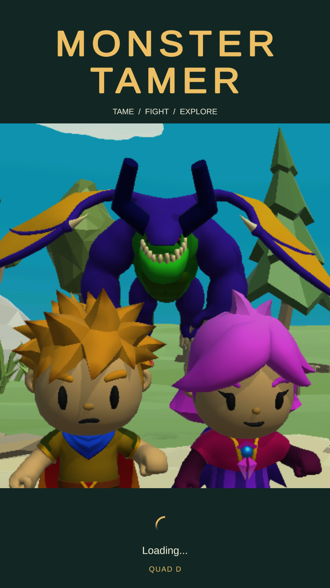
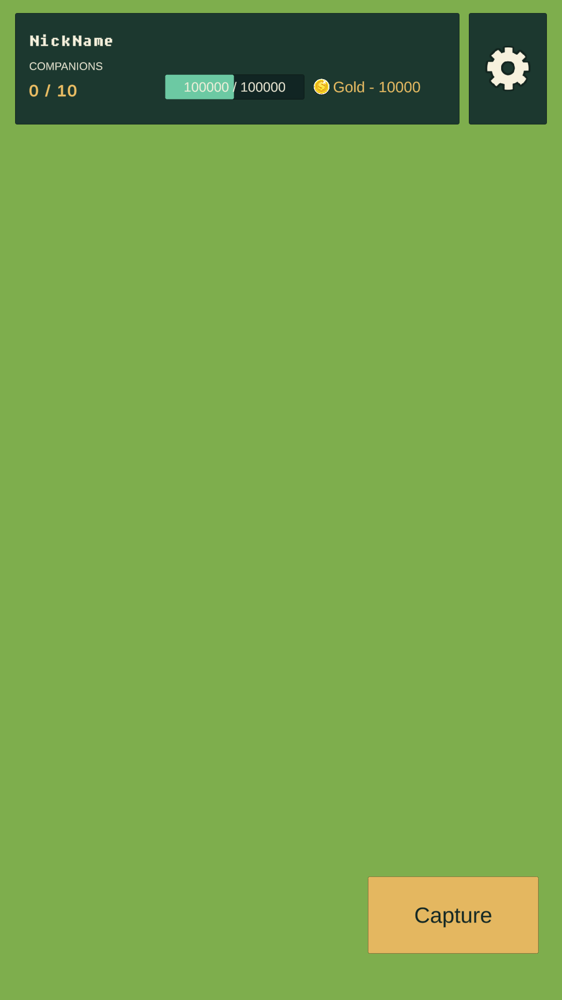
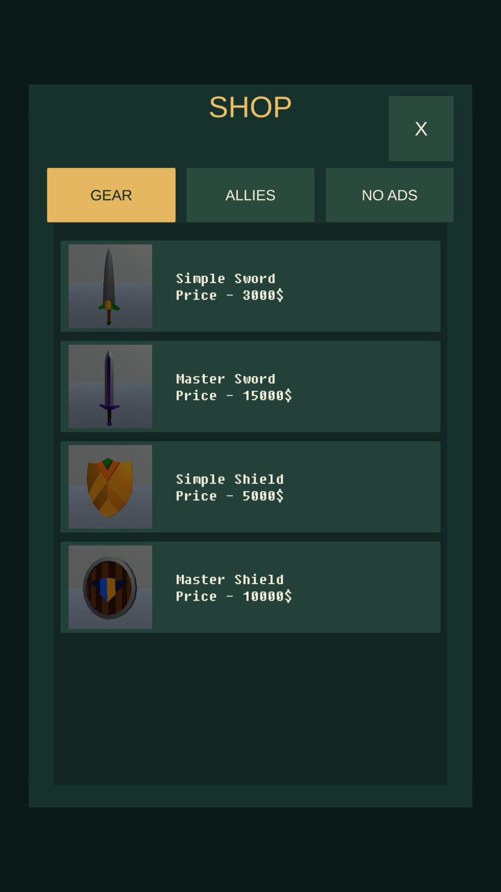

# 아이콘·UI 페이스리프트 검토안 — 2026-10-29

사용자 요청으로 앱 아이콘과 게임 전반 UI의 첫 스타일을 적용했습니다. 실제 작업본은 `D:/codex/worktrees/tamer-working/Tamer`, UI 코드 커밋은 `codex/ui-facelift-1029@493b87dbc57a1b55d19302aac239e50a310b36dc`입니다. [인트로 PR #492](https://github.com/ChoiDaeYoung-94/Tamer/pull/492)를 기반으로 하며 [이슈 #491](https://github.com/ChoiDaeYoung-94/Tamer/issues/491)에서 추적합니다. 사용자 화면 검토와 운영 검증이 남아 있어 완료·배포 상태로 표현하지 않습니다.

짙은 녹색 패널과 금색 주요 버튼, 밝은 본문으로 표현을 통일했습니다. 로그인 제목·로딩·닉네임 입력, 마을/전투 공통 HUD와 포획·설정 버튼, 플레이어 정보 팝업, 상점 탭·목록·구매 안내, 설정·종료/회복 팝업, 캐릭터 선택·조이스틱·전환 화면을 다듬었습니다. 상점에는 기존 팝업 닫기 동작으로 연결한 명시적 닫기 버튼을 추가했습니다. No Ads의 고정 가격 문구는 제거하고 Google Play에서 실제 가격을 확인하도록 안내합니다.

기존 금발 캐릭터와 박쥐 동료를 살린 새 아이콘을 제작해 기본·Android legacy/round·adaptive 슬롯에 연결했습니다. 적응형 아이콘은 별도 투명 전경과 단색 배경을 사용합니다. [최종 에셋·도구·전체 프롬프트](../images/facelift-assets-20261029.ko.md)를 함께 기록했습니다. 한글이 필요한 설정/개인정보 UI의 기존 글꼴과 원래 atlas를 유지하고 별도 재질로 외곽선만 정리했습니다.

## 미리보기와 검증 범위

아래 그림은 Editor API로 원래 UI를 복사해 게임 스크립트를 제외하고 렌더링한 **1080×1920 시각 전용 미리보기**입니다. HUD 배경은 단색이며 이름·HP·상점 값은 prefab의 예시 값입니다. 실제 게임 플레이·운영 계정·실제 결제 가격이나 최종 기기 화면의 증거로 사용하지 않습니다. 캐릭터 선택 미리보기는 UI 배치만 렌더링했습니다.

| 로그인 | 공통 HUD | 상점 |
| --- | --- | --- |
|  |  |  |

Unity `6000.3.25f1` / `e1dba0a9aba4`, CLI `1.0.0-beta.8`에서 UI lifecycle 8/8, 계정 삭제 UI 12/12, 연령/개인정보 UI 3/3, 신규 facelift 검사 4/4가 통과했습니다. 신규 검사는 적응형 레이어·투명 여백, 한글 글꼴 유지, 상점 닫기 버튼의 정확한 대상을 확인합니다. 여러 필터를 합친 최초 요청은 0건이어서 통과로 계산하지 않았습니다.

`verify_ui_bindings.py --base 5abdc330099cd3262bef72861d1e0c87c9b0b6c1`로 7개 에셋의 기존 직렬화 객체 1,524개, 이벤트 필드 278개, 게임플레이 컴포넌트 41개 및 원래 metadata를 대조했습니다. UI 밖의 기존 객체와 이벤트/게임플레이 필드를 보존하고 새 비 UI 객체가 없는지 확인했습니다. Editor 저장 과정의 광고 설정·비 UI 씬 직렬화 부수 변경은 원래 문서로 복원했습니다. 새 인트로 관련 검사·실제 Android 검증은 [인트로 기록](quad-d-intro-and-estimate-20261029.ko.md)과 구분합니다.

미검증: 변경 UI가 실제 마을/전투·상점·동적 개인정보 화면에서 함께 동작하는지, 다른 화면 비율/노치에서의 배치와 터치, 실제 Android 아이콘·시작 화면, 기존 계정/저장·구매 복원 및 새 최종 후보. 원래 버튼 연결 보존이나 격리 시각 확인을 운영 검증 완료로 대체하지 않습니다.

## 확장 후 남은 기간 추정

| 남은 묶음 | 직접 작업 추정 |
| --- | --- |
| UI 통합·화면 비율/동적 팝업 검증·사용자 피드백 반영 | 6~10시간 |
| 인트로 Android 영상/음향·복귀 확인 | 1~2시간 |
| 기존 운영 기능·계정/저장·구매 복원 확인과 필요한 수정 | 8~12시간 |
| 심사 접근정보·새 최종 후보·스토어 최종 정리 | 4~6시간 |
| 사용자 검토/심사 준비 후보까지 | **19~30시간** |

산식은 위 네 묶음의 하한/상한 합계이며, 하루 유효 5~6시간이면 `19/6≈3.2`부터 `30/5=6`을 올림해 **약 4~6작업일**입니다. 계정/인증과 심사용 별도 기존 계정이 바로 준비되고 큰 운영 결함이 없다는 전제입니다. 추가 디자인 요구·인증 대기·Google 심사 시간과 출시 후 정리 3~6시간은 별도입니다. UI 초안이 빠르게 적용된 시간을 전체 운영 검증 속도로 환산하지 않았습니다. 실제 심사 전송·배포·트랙 재개는 사용자 검토 이후에 진행합니다.
